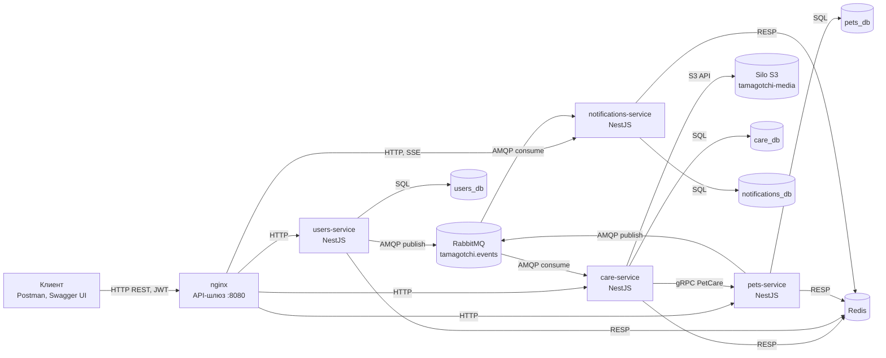
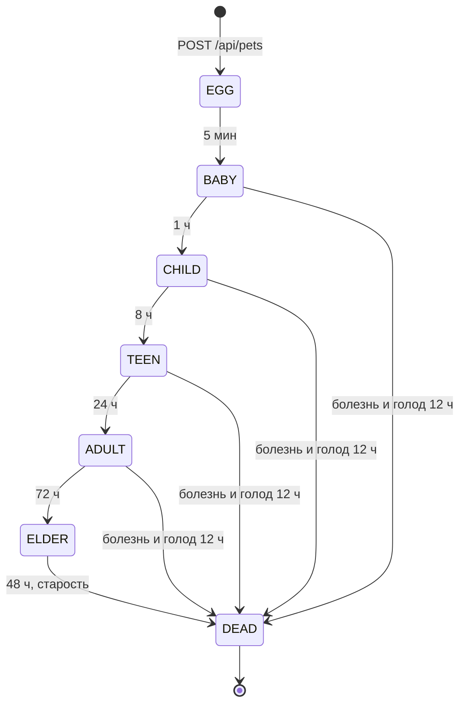
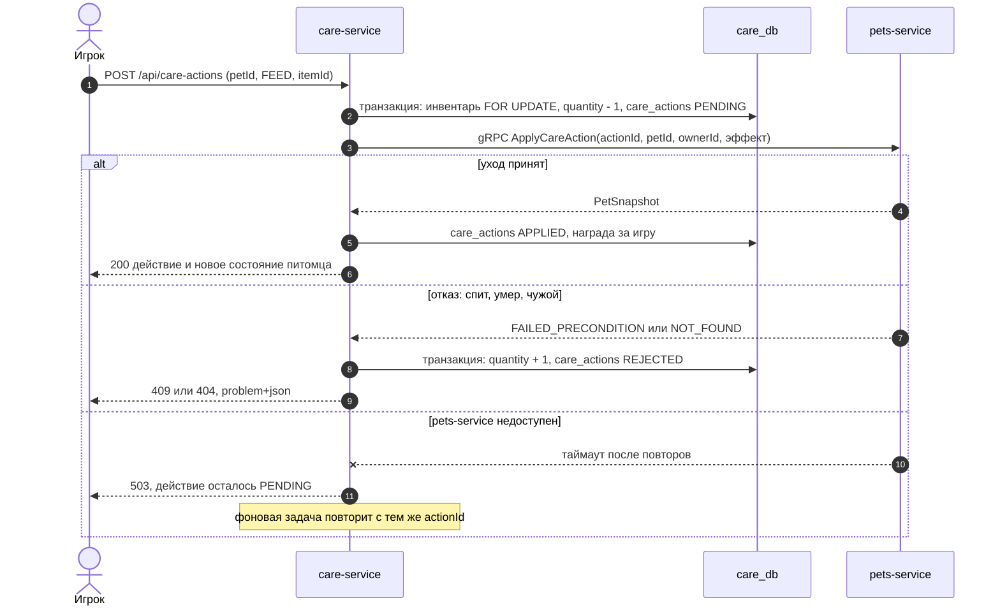

# Архитектура: система ухода за виртуальными питомцами

> Единый источник правды для кода, Swagger, диаграмм и пояснительной записки.
> Меняется код – меняется этот файл, и наоборот.

Тема: «Разработка серверной части системы ухода за виртуальными питомцами (тамагочи)».
Курсовой проект по Backend, студент – Костромина М. К., ведущий преподаватель – Кожухов Д. А.

---

## 1. Требования задания и чем они закрыты

| Требование (задание КП, критерии на «5») | Решение |
|---|---|
| Не менее 4 микросервисов, один – основная бизнес-логика | `users-service`, `pets-service` (основная логика: жизнь питомца), `care-service`, `notifications-service` |
| Хотя бы одно асинхронное взаимодействие через брокер в реальном сценарии | RabbitMQ: `user.registered` – стартовый набор; `pet.hungry` / `pet.sick` / `pet.evolved` / `pet.died` – уведомления; `pet.evolved` – награда монетами |
| Внешний API, контракт каждого метода, Swagger | REST за nginx, `@nestjs/swagger` в каждом сервисе, общий `docs/openapi/tamagotchi.json` для преподавателя |
| Реляционная БД, ORM, целостность связанных изменений | PostgreSQL, TypeORM, транзакции, блокировки строк, outbox и inbox, компенсация в уходе |
| Протоколы выбраны обоснованно | HTTP/REST для клиента, gRPC между `care` и `pets`, AMQP для событий, SSE для живых уведомлений |
| Аутентификация и авторизация, JWT | JWT RS256, роли `player` и `admin`, отзыв токена через Redis |
| Валидация, хеш паролей, без stack trace, секреты не в коде | `class-validator`, argon2, ошибки в формате `application/problem+json`, `.env` и файлы ключей вне репозитория |
| Единообразный формат ошибок | RFC 9457 Problem Details во всех сервисах (общий фильтр) |
| Решение на «5» (минимум одно) | **объектное хранилище** (Silo) и **распределённый кэш** (Redis); запас – observability по лекции 10 |
| Диаграммы компонентов, БД, классов на каждый сервис | `docs/diagrams/Проектирование.drawio` по образцу преподавателя: компоненты, 3 листа БД, по листу классов на сервис, 2 последовательности; все классы с полями и методами – `docs/diagrams/Классы подробно.drawio` |

## 2. Предметная область

Система – серверная часть игры о виртуальных питомцах по мотивам Tamagotchi (Bandai, 1996).
Игрок заводит питомца из яйца, кормит его, играет с ним, убирает, лечит и воспитывает. Без ухода
показатели падают сами: питомец голодает, грустит, пачкает комнату, болеет и может умереть.
От качества ухода зависит, в какую форму он вырастет на каждой стадии жизни.

Сервер хранит питомцев и моделирует их жизнь во времени, даже когда игрок не в сети, ведёт
игровую экономику (монеты, магазин, инвентарь) и сообщает игроку о важных событиях: питомец
голоден, заболел, вырос, умер. Клиентом может быть любое приложение; фронтенд в работу не входит,
API демонстрируется через Swagger UI и Postman.

**Акторы:** Гость, Игрок (`player`), Администратор (`admin`), Система (планировщик жизненного цикла).

| № | Бизнес-функция | Актор | В работе |
|---|---|---|---|
| 1 | Регистрация, вход, выход | Гость, Игрок | да |
| 2 | Профиль: просмотр, смена ника и пароля | Игрок | да |
| 3 | Завести питомца (вылупление из яйца), не более 3 живых | Игрок | да |
| 4 | Состояние питомца: сытость, настроение, дисциплина, вес, болезнь, стадия, форма | Игрок | да |
| 5 | Уход: кормить, угостить, играть, убрать, лечить, воспитывать, выключить свет | Игрок | да |
| 6 | Жизнь во времени: голод, грусть, болезни, ошибки ухода, рост по стадиям, смерть | Система | да |
| 7 | Магазин и инвентарь: каталог, покупка за монеты | Игрок | да |
| 8 | Кошелёк: баланс, история операций, награды за игру и рост | Игрок, Система | да |
| 9 | Уведомления: список, прочитать, удалить, живой поток | Игрок | да (поток – по желанию) |
| 10 | Хронология жизни питомца и история ухода | Игрок | да |
| 11 | Каталог предметов: создать, изменить, отключить, загрузить иконку | Администратор | да |
| 12 | Перемотка времени питомца для демонстрации | Администратор | да (только `DEMO_MODE`) |
| 13 | Обмен питомцами и предметами между игроками | Игрок | нет |
| 14 | Рейтинг долгожителей, сезонные события | Игрок | нет |
| 15 | Push-уведомления на телефон, генеалогия (потомство после смерти) | Игрок | нет |

## 3. Стек

Стек – как у Канева (iu5git/Web), брокер и gRPC – по лекциям курса. Язык и стек по заданию
согласуются с преподавателем.

| Слой | Технология | Опора |
|---|---|---|
| Язык, фреймворк | TypeScript 6, NestJS 12 (монорепозиторий Nest CLI, сборка tsc, модули CommonJS), Node.js 24 LTS | Канев: lab2-nest, lab3-nest, lab4-nest |
| ORM и миграции | TypeORM, миграции, `synchronize: false` | lab2-nest, lab3-nest |
| СУБД | PostgreSQL 18: один сервер, 4 базы, у каждого сервиса своя учётная запись | lab2-nest, git-docker; образец преподавателя |
| Брокер | RabbitMQ 4 (`amqplib` + `amqp-connection-manager`), management UI | лекция 04; Канев, лекция 13 |
| Сервис – сервис | gRPC (`@nestjs/microservices`, `@grpc/grpc-js`) | лекция 02 (FeedingService – CatsService); Канев, лекция 13 |
| Кэш и отзыв токенов | Redis 7 (`ioredis`) | Канев: lab4-nest, redis |
| Файлы | Silo (S3-совместимый форк MinIO), пакет `minio` | Канев: silo, lab3-nest; лекция 11 |
| Документация API | `@nestjs/swagger`, OpenAPI 3 | Канев: лекции 5–7, lab4-nest |
| Валидация | `class-validator`, `class-transformer`, глобальный `ValidationPipe` | lab3-nest |
| JWT | `@nestjs/jwt`, RS256 | Канев, лекция 7 |
| Пароли | `argon2` | образец преподавателя (`Argon2PasswordHasher`) |
| Фоновые задачи | `@nestjs/schedule` | лекция 09 |
| Шлюз | nginx | лекция 08 |
| Устойчивость | `cockatiel`: таймаут, ретрай, circuit breaker | лекция 12 (Polly) |
| Запуск | Docker Compose, Adminer | Канев: git-docker |
| Тесты и стиль | Jest (правила жизни питомца), e2e-сценарий, коллекция Postman; ESLint и Prettier | |
| Наблюдаемость (запас) | OpenTelemetry → Collector → Prometheus, Loki, Tempo → Grafana | лекция 10 |

## 4. Микросервисы

### 4.1 users-service – пользователи
- **Назначение:** регистрация, вход, выпуск JWT, профиль, роли.
- **Данные:** `users_db` – `users`, `outbox_messages`.
- **API:** `/api/auth/*`, `/api/users/*`.
- **Взаимодействия:** публикует `user.registered`; подписывает токены закрытым ключом, остальные
  сервисы проверяют их открытым ключом без обращения к `users-service`.
- **Фон:** ретранслятор outbox раз в секунду.

### 4.2 pets-service – питомцы (основная бизнес-логика)
- **Назначение:** питомцы и их жизнь во времени: падение показателей, болезни, ошибки ухода,
  эволюция, смерть; применение эффектов ухода.
- **Данные:** `pets_db` – `pets`, `pet_forms`, `pet_events`, `applied_care_actions`, `outbox_messages`.
- **API:** `/api/pets/*`, `/api/admin/pets/*`; gRPC-сервер `PetCare` для `care-service`.
- **Взаимодействия:** публикует `pet.hungry`, `pet.sick`, `pet.evolved`, `pet.died`.
- **Фон:** планировщик жизненного цикла (раздел 8), ретранслятор outbox.

### 4.3 care-service – уход и предметы
- **Назначение:** каталог предметов, кошелёк, магазин, инвентарь, действия ухода.
- **Данные:** `care_db` – `items`, `wallets`, `wallet_transactions`, `inventory_items`,
  `purchases`, `care_actions`, `processed_events`.
- **API:** `/api/items/*`, `/api/inventory`, `/api/purchases`, `/api/wallet`, `/api/care-actions`.
- **Взаимодействия:** gRPC-клиент `PetCare`; потребляет `user.registered` (стартовый набор) и
  `pet.evolved` (награда); Silo – иконки предметов; Redis – кэш каталога.
- **Фон:** досылка зависших действий ухода (раздел 9).

### 4.4 notifications-service – уведомления
- **Назначение:** превращает события в уведомления игроку, хранит их, отдаёт списком и потоком.
- **Данные:** `notifications_db` – `notifications`, `notification_settings`, `processed_events`.
- **API:** `/api/notifications/*`.
- **Взаимодействия:** потребляет `user.registered`, `pet.hungry`, `pet.sick`, `pet.evolved`,
  `pet.died`; поток SSE клиенту.
- **Правила:** уведомление сохраняется в транзакции inbox, если тип не выключен в
  `notification_settings` (нет строки – присылаются все, приветствие – всегда); в поток SSE оно уходит
  после коммита (подписчик TypeORM `afterTransactionCommit`) и только соединениям того экземпляра,
  который обработал событие. Курсор списка – непрозрачная строка base64url из `created_at` с
  микросекундами и `id` последнего элемента; неверный курсор – 400 `invalid-cursor`.

## 5. Компоненты и протоколы



| Откуда → куда | Протокол | Зачем | Почему так |
|---|---|---|---|
| Клиент → nginx → сервисы | HTTP/REST, JSON, Bearer JWT | внешний API | стандарт для внешних клиентов, Swagger из коробки |
| care → pets | gRPC (protobuf) | применить уход и сразу вернуть новое состояние | игроку нужен немедленный ответ; строгий контракт `.proto`, быстрая бинарная передача внутри сети |
| users, pets → RabbitMQ → care, notifications | AMQP 0-9-1 | события жизни игрока и питомца | отправителю не нужен ответ; получатели могут быть недоступны – сообщение подождёт в очереди |
| notifications → клиент | SSE поверх HTTP | живой поток уведомлений | поток только от сервера к клиенту, проще WebSocket |
| сервисы → PostgreSQL | SQL поверх TCP | хранение | у каждого сервиса своя база (database per service) |
| сервисы → Redis | RESP | отзыв токенов, кэш каталога | общее быстрое хранилище для всех экземпляров |
| care → Silo | S3 API поверх HTTP | иконки предметов | файлы не хранятся в БД, ссылка отдаётся клиенту |

Контракт gRPC (`libs/contracts/proto/pets.proto`):

```proto
syntax = "proto3";
package pets.v1;

service PetCare {
  rpc ApplyCareAction (ApplyCareActionRequest) returns (PetSnapshot);
  rpc GetPetSnapshot (GetPetSnapshotRequest) returns (PetSnapshot);
}

message ApplyCareActionRequest {
  string action_id = 1;      // ключ идемпотентности: повтор не применит эффект дважды
  string pet_id = 2;
  string owner_id = 3;       // pets-service проверяет владельца
  string type = 4;           // FEED, SNACK, PLAY, CLEAN, HEAL, SCOLD, LIGHTS_OFF, LIGHTS_ON
  int32 hunger_delta = 5;
  int32 happiness_delta = 6;
  int32 weight_delta = 7;
  bool cures_sickness = 8;
}

message GetPetSnapshotRequest {
  string pet_id = 1;
  string owner_id = 2;
}

message PetSnapshot {
  string pet_id = 1;
  string name = 2;
  string stage = 3;
  string form_code = 4;
  int32 hunger = 5;
  int32 happiness = 6;
  int32 discipline = 7;
  int32 weight = 8;
  int32 poop_count = 9;
  bool is_sick = 10;
  bool is_sleeping = 11;
  int32 care_mistakes = 12;
  bool care_mistake_made = 13; // этим действием допущена ошибка ухода
}
```

Ошибки gRPC: `NOT_FOUND` – нет питомца или он чужой (HTTP 404), `FAILED_PRECONDITION` – спит, ещё
яйцо, умер (HTTP 409), `UNAVAILABLE` / `DEADLINE_EXCEEDED` – повтор с тем же `action_id` (HTTP 503),
`INVALID_ARGUMENT` – неизвестный `type` или `action_id` не UUID (HTTP 400 `care-invalid`, действие
REJECTED с `reject_reason = INVALID_CARE_REQUEST`, без повторов).

## 6. Асинхронные события

**Топология.** Exchange `tamagotchi.events` типа `topic`, durable. У каждого потребителя своя
очередь (quorum, `x-delivery-limit: 5`), после пяти неудачных доставок сообщение уходит в
`tamagotchi.events.dlx` (тип `direct`, ключ – имя очереди, чтобы недоставленные одного сервиса
не попали в DLQ другого) и очередь `<сервис>.events.dlq`. RabbitMQ 4 не считает `nack` с возвратом
неудачной доставкой, поэтому счёт ведёт потребитель по заголовку `x-acquired-count`: после ошибки
обработчика – повтор через паузу (1 с × номер доставки), пятая неудача – `nack` без возврата, и брокер
перекладывает сообщение в DLQ; `x-delivery-limit` срабатывает на доставках, оборванных падением
потребителя. В сервисе на один ключ маршрутизации – один обработчик.

| Очередь | Привязки |
|---|---|
| `care-service.events` | `user.registered`, `pet.evolved` |
| `notifications-service.events` | `user.registered`, `pet.*` |

**Каталог событий.**

| Ключ | Отправитель | Получатели и реакция | Данные |
|---|---|---|---|
| `user.registered` | users | care – кошелёк 100 монет и стартовый набор; notifications – приветствие | `userId`, `login`, `nickname`, `registeredAt` |
| `pet.hungry` | pets | notifications – «Питомец голоден» | `petId`, `ownerId`, `petName`, `since` |
| `pet.sick` | pets | notifications – «Питомец заболел» | `petId`, `ownerId`, `petName`, `cause` |
| `pet.evolved` | pets | notifications – «Питомец вырос»; care – награда за стадии ADULT и ELDER | `petId`, `ownerId`, `petName`, `fromStage`, `toStage`, `formCode`, `careMistakes` |
| `pet.died` | pets | notifications – «Питомец умер» | `petId`, `ownerId`, `petName`, `cause`, `ageDays` |

**Конверт сообщения** (свойство AMQP `messageId` = `eventId`, `persistent: true`):

```json
{
  "eventId": "8f0d2c1e-4c5b-4b8e-9a51-2f7f1c9d0e11",
  "type": "pet.hungry",
  "version": 1,
  "occurredAt": "2026-11-05T10:15:00Z",
  "payload": { "petId": "…", "ownerId": "…", "petName": "Пушок", "since": "2026-11-05T10:15:00Z" }
}
```

**Гарантии.**
- **Transactional outbox** у отправителей: изменение данных и запись события в `outbox_messages`
  делаются одной транзакцией. Ретранслятор раз в секунду берёт неотправленные записи
  (`FOR UPDATE SKIP LOCKED`), публикует с подтверждением брокера (publisher confirms) и ставит
  `published_at`. Событие не потеряется, даже если брокер лежал в момент операции.
- **Идемпотентный потребитель (inbox):** запись в `processed_events (event_id PK)` и действие делаются
  одной транзакцией; повторная доставка того же `eventId` пропускается.
- **Ручной ack** после коммита, `prefetch = 10`. Доставка «хотя бы один раз» плюс идемпотентность
  дают эффект «ровно один раз».

## 7. Базы данных

Один сервер PostgreSQL 18, четыре базы. Ссылки между базами – только UUID без внешних ключей
(как `user_uid` в образце преподавателя), с индексом. Деньги и счётчики – целые числа, время –
`TIMESTAMPTZ`, ограничения – `CHECK` в самой БД.

**users_db**

| Таблица | Поля |
|---|---|
| `users` | `id UUID PK`, `login VARCHAR(32) UK`, `nickname VARCHAR(32)`, `password_hash VARCHAR(255)`, `role VARCHAR(10) CHECK (player, admin)`, `created_at`, `updated_at` |
| `outbox_messages` | `id UUID PK`, `routing_key VARCHAR(64)`, `payload JSONB`, `created_at`, `published_at N`, `attempts INTEGER`, `last_error VARCHAR(512) N` |

**pets_db**

| Таблица | Поля |
|---|---|
| `pets` | `id UUID PK`, `owner_id UUID IX`, `name VARCHAR(24)`, `stage VARCHAR(8) CHECK`, `form_code VARCHAR(32) FK`, `hunger SMALLINT 0–4`, `happiness SMALLINT 0–4`, `discipline SMALLINT 0–100`, `weight SMALLINT`, `poop_count SMALLINT 0–4`, `is_sick BOOLEAN`, `is_sleeping BOOLEAN`, `attention VARCHAR(12) N`, `attention_since N`, `mistake_counted BOOLEAN`, `care_mistakes SMALLINT`, `starving_since N`, `born_at`, `stage_since`, `simulated_at`, `next_tick_at IX`, `died_at N`, `death_cause VARCHAR(10) N`, `created_at`, `updated_at` |
| `pet_forms` | `code VARCHAR(32) PK`, `stage VARCHAR(8)`, `title VARCHAR(32)`, `description VARCHAR(256)`, `image_key VARCHAR(128)` – справочник форм, картинки в Silo |
| `pet_events` | `id BIGSERIAL PK`, `pet_id UUID FK`, `type VARCHAR(16)`, `details JSONB`, `occurred_at` – хронология |
| `applied_care_actions` | `action_id UUID PK`, `pet_id UUID FK`, `type VARCHAR(12)`, `result JSONB`, `applied_at` – идемпотентность gRPC |
| `outbox_messages` | как в `users_db` |

**care_db**

| Таблица | Поля |
|---|---|
| `items` | `id UUID PK`, `code VARCHAR(32) UK`, `title VARCHAR(64)`, `description VARCHAR(256)`, `category VARCHAR(10) CHECK (FOOD, SNACK, MEDICINE, TOY)`, `price INTEGER ≥ 0`, `is_consumable BOOLEAN`, `hunger_delta SMALLINT`, `happiness_delta SMALLINT`, `weight_delta SMALLINT`, `cures_sickness BOOLEAN`, `icon_key VARCHAR(128) N`, `is_active BOOLEAN`, `created_at`, `updated_at` |
| `wallets` | `user_id UUID PK`, `balance INTEGER ≥ 0`, `updated_at` |
| `wallet_transactions` | `id BIGSERIAL PK`, `user_id UUID FK`, `amount INTEGER`, `balance_after INTEGER`, `reason VARCHAR(20) CHECK (STARTER_KIT, PURCHASE, PLAY_REWARD, EVOLUTION_REWARD)`, `reference_id UUID N`, `created_at` |
| `inventory_items` | `user_id UUID PK`, `item_id UUID PK FK`, `quantity INTEGER ≥ 0`, `updated_at` |
| `purchases` | `id UUID PK`, `user_id UUID IX`, `item_id UUID FK`, `quantity SMALLINT`, `unit_price INTEGER`, `total_price INTEGER`, `created_at` |
| `care_actions` | `id UUID PK`, `user_id UUID IX`, `pet_id UUID IX`, `type VARCHAR(12) CHECK`, `item_id UUID FK N`, `status VARCHAR(10) CHECK (PENDING, APPLIED, REJECTED)`, `attempts SMALLINT`, `result JSONB N`, `reject_reason VARCHAR(32) N`, `created_at`, `completed_at N` |
| `processed_events` | `event_id UUID PK`, `routing_key VARCHAR(64)`, `processed_at` |

**notifications_db**

| Таблица | Поля |
|---|---|
| `notifications` | `id UUID PK`, `user_id UUID IX`, `type VARCHAR(16) CHECK (WELCOME, PET_HUNGRY, PET_SICK, PET_EVOLVED, PET_DIED)`, `title VARCHAR(96)`, `body VARCHAR(512)`, `pet_id UUID N`, `is_read BOOLEAN`, `created_at`, `read_at N` |
| `notification_settings` | `user_id UUID PK`, `pet_hungry BOOLEAN`, `pet_sick BOOLEAN`, `pet_evolved BOOLEAN`, `pet_died BOOLEAN`, `updated_at` |
| `processed_events` | как в `care_db` |

Транзакции, которые проверят на защите:
- покупка: блокировка кошелька `FOR UPDATE`, списание, запись в журнал, пополнение инвентаря, запись покупки – одна транзакция;
- стартовый набор: inbox, кошелёк, журнал, предметы – одна транзакция;
- тик питомца: питомец, хронология, outbox – одна транзакция;
- применение ухода в `pets-service`: питомец, `applied_care_actions`, хронология – одна транзакция.

## 8. Жизненный цикл питомца

Правила по мотивам оригинального Tamagotchi P1; числа взяты из открытой реализации
usik/tamagotchi (MIT) и доработаны: там игнорирование зова не считается ошибкой, у нас считается.
Время игровое, `GAME_SPEED` задаёт его скорость (1 – реальное время).

| Параметр | Правило |
|---|---|
| Сытость, настроение | 0–4 сердечка, старт 4; −1 каждые 30 мин, во сне не падают |
| Дисциплина | 0–100, старт 0; −5 каждые 6 ч; «воспитать» капризного +25 |
| Вес | старт 10; еда +1, лакомство +3, игра −1 (дельты из предмета), не меньше 1 |
| Какашки | +1 каждые 3 ч ± 15 мин (сдвиг постоянный для питомца); при 4 – болезнь (и снова, если вылечили, а не убрали); «убрать» обнуляет |
| Сон | «выключить свет» – засыпает, «включить свет» – просыпается; спящему доступно только «включить свет», остальное – отказ (спит) |
| Зов (attention) | сытость 0 – HUNGRY (событие `pet.hungry`); настроение 0 – UNHAPPY; какашек 3 и больше – DIRTY; болезнь – SICK (`pet.sick`); капризы – MISBEHAVING с вероятностью 10 % в каждую отметку 30 мин, если питомец не спит и ничего не требует; закрывается только «воспитать». Зов один – самый важный: SICK > HUNGRY > DIRTY > UNHAPPY > MISBEHAVING |
| Ошибка ухода | зов не закрыт за 15 мин (один раз на эпизод; смена зова – новый эпизод); кормить сытого; лечить здорового; ругать без каприза. Счётчик общий на всю жизнь |
| Яйцо | показатели не меняются, уход – отказ (ещё яйцо) |
| Смерть | болен и голоден без перерыва 12 ч – NEGLECT; конец стадии ELDER – OLD_AGE (`pet.died`) |
| Стадии | EGG 5 мин → BABY 1 ч → CHILD 8 ч → TEEN 24 ч → ADULT 72 ч → ELDER 48 ч |
| Форма при переходе | по числу ошибок ухода: меньше 2 – хорошая, 2–4 – обычная, 5 и больше – плохая; лучшая взрослая форма требует ещё дисциплины от 50 |



**Алгоритм тика.** Каждые `TICK_MS` (5 с) планировщик в транзакции выбирает до 100 живых
питомцев с `next_tick_at <= now()` через `FOR UPDATE SKIP LOCKED` (несколько экземпляров сервиса
не возьмут одного питомца дважды), вызывает чистую функцию `simulate(pet, now, rules, rng)`,
сохраняет новое состояние, строки хронологии и события в outbox. Функция `simulate` не трогает
БД и покрыта unit-тестами: на ней держится вся игровая логика.

Все периодические отметки считаются от `born_at` (`born_at + k × 30 мин` и т. д.), поэтому отдельных
счётчиков в БД нет. `simulate` проходит события по порядку от `simulated_at` до `now` и ставит
`next_tick_at` на ближайшее следующее событие: питомец попадает в тик только тогда, когда с ним
что-то должно случиться. Уход по gRPC сначала доживает питомца до текущего момента (события – в outbox),
затем применяет `CareRules.applyCare` и ставит `next_tick_at = now()`, чтобы тик пересчитал расписание.

Хронология (`pet_events.type`): `BORN`, `EVOLVED`, `HUNGRY`, `UNHAPPY`, `DIRTY`, `SICK`, `MISBEHAVING`
(начало зова), `CARE` (уход), `CARE_MISTAKE` (`details.reason`: `IGNORED_CALL`, `OVERFED`,
`NEEDLESS_HEAL`, `NEEDLESS_SCOLD`), `DIED`.

Перемотка для демонстрации: `POST /api/admin/pets/{petId}/time-travel {gameMinutes}` сдвигает
отметки времени питомца и его хронологию назад и сразу прогоняет `simulate`. Работает только при
`DEMO_MODE=true`, иначе 403; `gameMinutes` – от 1 до 14 400. Умерший питомец не меняется.

**Формы питомца** (справочник `pet_forms`, сид pets-service, `apps/pets-service/src/pets/pet-forms.catalog.ts`;
картинка – `pet-forms/<код>.png` в Silo; рисует и загружает сид, если ему заданы `SILO_ENDPOINT` и ключи). Форма выбирается при переходе на стадию по правилу из таблицы выше:
`*_good` – ошибок ухода меньше 2, `*_normal` – 2–4, `*_bad` – 5 и больше; `adult_star` – меньше 2 ошибок
и дисциплина от 50.

| Код | Стадия | Название | Когда |
|---|---|---|---|
| `egg` | EGG | Яйцо | новый питомец |
| `baby` | BABY | Пушинка | всегда |
| `child_good` | CHILD | Солнышко | ошибок < 2 |
| `child_normal` | CHILD | Колобок | 2–4 ошибки |
| `child_bad` | CHILD | Ворчун | 5 и больше |
| `teen_good` | TEEN | Звёздочка | ошибок < 2 |
| `teen_normal` | TEEN | Непоседа | 2–4 ошибки |
| `teen_bad` | TEEN | Хулиган | 5 и больше |
| `adult_star` | ADULT | Чемпион | ошибок < 2 и дисциплина ≥ 50 |
| `adult_good` | ADULT | Умница | ошибок < 2, дисциплина < 50 |
| `adult_normal` | ADULT | Добряк | 2–4 ошибки |
| `adult_bad` | ADULT | Обжора | 5 и больше |
| `elder` | ELDER | Мудрец | всегда |

## 9. Уход за питомцем – распределённая операция

Предмет списывается в `care_db`, эффект применяется в `pets_db`. Общей транзакции у двух баз нет,
поэтому операция сделана сагой с компенсацией и идемпотентным повтором.



- `pets-service` хранит `action_id` в `applied_care_actions`: повтор вернёт прежний результат,
  а не накормит второй раз.
- Вызов gRPC обёрнут в `cockatiel`: таймаут 2 с, 2 повтора, circuit breaker.
- Досылка: раз в 30 с `care-service` повторяет действия в PENDING старше 30 с; после 5 попыток
  возвращает предмет и ставит REJECTED (`reject_reason = PETS_UNAVAILABLE`). Строка действия на время
  повтора заблокирована `FOR UPDATE SKIP LOCKED`, поэтому два экземпляра не повторят его одновременно,
  а завершённое действие (не PENDING) не меняется и предмет не возвращается дважды.
- Отказ pets-service записывается в `reject_reason`: машинный код из `details` ошибки gRPC
  (например `PET_SLEEPING`), иначе `PET_NOT_FOUND`, `PET_UNAVAILABLE` или `INVALID_CARE_REQUEST`.
- Предметы без расхода (игрушка) и действия без предмета (убрать, свет, воспитать) идут тем же путём,
  только без шага с инвентарём.
- Награда: «играть» даёт 5 монет, только если настроение действительно выросло (защита от фарма):
  перед `ApplyCareAction` для PLAY вызывается `GetPetSnapshot`, награда – если `happiness` после больше, чем до.
- История ухода с `petId` проверяет питомца через `GetPetSnapshot`: `NOT_FOUND` – 404; если pets-service
  недоступен, история отдаётся без проверки (в ней только действия самого игрока).

**Действие и предмет.** FEED – предмет FOOD, SNACK – SNACK, HEAL – MEDICINE (все тратятся), PLAY –
игрушка TOY (не тратится); CLEAN, SCOLD, LIGHTS_OFF, LIGHTS_ON – без предмета. Предмет другой категории
или его нет в инвентаре – 409; действие с предметом без `itemId` или действие без предмета с `itemId` – 400. Эффект (`hunger_delta`, `happiness_delta`, `weight_delta`,
`cures_sickness`) берётся из предмета и передаётся в gRPC.

**Каталог предметов** (сид care-service, `apps/care-service/src/items/items.catalog.ts`; изменения сид
не перезаписывает иконку и `is_active`):

| Код | Название | Категория | Цена | Тратится | Сытость | Настроение | Вес | Лечит |
|---|---|---|---|---|---|---|---|---|
| `rice` | Рис | FOOD | 5 | да | +1 | 0 | +1 | нет |
| `fish` | Рыбка | FOOD | 12 | да | +2 | 0 | +1 | нет |
| `candy` | Конфета | SNACK | 8 | да | 0 | +1 | +3 | нет |
| `cake` | Пирожное | SNACK | 15 | да | 0 | +2 | +3 | нет |
| `pill` | Таблетка | MEDICINE | 20 | да | 0 | 0 | 0 | да |
| `ball` | Мячик | TOY | 30 | нет | 0 | +1 | −1 | нет |
| `teddy` | Плюшевый мишка | TOY | 60 | нет | 0 | +2 | −1 | нет |

**Стартовый набор и награды** (`apps/care-service/src/events/rewards.ts`): по `user.registered` – кошелёк
100 монет (STARTER_KIT) и предметы `rice` × 3, `candy` × 2, `pill` × 1, `ball` × 1; по `pet.evolved` –
50 монет за стадию ADULT и 100 за ELDER (EVOLUTION_REWARD); за игру – 5 монет (PLAY_REWARD).

## 10. Внешний API

Все запросы идут на `http://localhost:8080`. Кроме входа и регистрации, нужен заголовок
`Authorization: Bearer <JWT>`.

| № | Метод и URL | Роль | Назначение | Успех | Ошибки |
|---|---|---|---|---|---|
| 1 | `POST /api/auth/register` | гость | регистрация, публикует `user.registered` | 201 `userId`, `accessToken`, `expiresIn` | 400, 409 логин занят |
| 2 | `POST /api/auth/login` | гость | вход | 200 `userId`, `accessToken`, `expiresIn` | 400, 401 |
| 3 | `POST /api/auth/logout` | игрок | отзыв токена | 204 | 401 |
| 4 | `GET /api/users/me` | игрок | профиль | 200 | 401 |
| 5 | `PATCH /api/users/me` | игрок | смена ника | 200 | 400, 401 |
| 6 | `PUT /api/users/me/password` | игрок | смена пароля | 204 | 400, 401 старый пароль неверен |
| 7 | `POST /api/pets` | игрок | завести питомца (яйцо) | 201 питомец | 400, 401, 409 уже 3 живых |
| 8 | `GET /api/pets?status=alive\|dead` | игрок | мои питомцы | 200 список | 400, 401 |
| 9 | `GET /api/pets/{petId}` | игрок | состояние питомца | 200 | 401, 404 |
| 10 | `PATCH /api/pets/{petId}` | игрок | переименовать | 200 | 400, 401, 404, 409 питомец умер |
| 11 | `GET /api/pets/{petId}/events` | игрок | хронология жизни | 200 список | 401, 404 |
| 12 | `POST /api/admin/pets/{petId}/time-travel` | админ | перемотка времени (демо) | 200 состояние | 400, 401, 403, 404 |
| 13 | `GET /api/items?category=` | все | каталог (кэш Redis) | 200 список | 400 |
| 14 | `GET /api/items/{itemId}` | все | предмет | 200 | 404 |
| 15 | `POST /api/items` | админ | новый предмет | 201 | 400, 401, 403, 409 код занят |
| 16 | `PATCH /api/items/{itemId}` | админ | изменить, отключить | 200 | 400, 401, 403, 404 |
| 17 | `PUT /api/items/{itemId}/icon` | админ | загрузить иконку в Silo (multipart `icon`) | 200 `iconUrl` | 400, 401, 403, 404, 413, 415 |
| 18 | `GET /api/inventory` | игрок | мой инвентарь | 200 | 401 |
| 19 | `POST /api/purchases` | игрок | купить предмет | 201 покупка, баланс | 400, 401, 404, 409 не хватает монет |
| 20 | `GET /api/wallet?limit=` | игрок | баланс и журнал операций | 200 | 400, 401 |
| 21 | `POST /api/care-actions` | игрок | действие ухода | 200 действие, питомец | 400 (и отказ pets-service `INVALID_ARGUMENT`), 401, 404, 409, 503 |
| 22 | `GET /api/care-actions?petId=&limit=` | игрок | история ухода | 200 | 400, 401, 404 |
| 23 | `GET /api/notifications?unreadOnly=&cursor=` | игрок | уведомления, курсорная пагинация | 200 | 400, 401 |
| 24 | `GET /api/notifications/unread-count` | игрок | число непрочитанных | 200 | 401 |
| 25 | `PATCH /api/notifications/{id}` | игрок | отметить прочитанным | 200 | 400, 401, 404 |
| 26 | `POST /api/notifications/read-all` | игрок | прочитать все | 204 | 401 |
| 27 | `DELETE /api/notifications/{id}` | игрок | удалить | 204 | 401, 404 |
| 28 | `GET /api/notifications/stream` | игрок | поток SSE (по желанию) | 200 `text/event-stream` | 401 |
| 29 | `GET /api/notifications/settings` | игрок | какие уведомления присылать (по желанию) | 200 | 401 |
| 30 | `PUT /api/notifications/settings` | игрок | изменить настройки уведомлений (по желанию) | 200 | 400, 401 |

Чужой питомец или чужое уведомление – 404, а не 403: так не раскрывается, что объект существует.
Неверный UUID в пути – тоже 404 (объекта с таким id нет). Иконка (№ 17) – PNG, JPEG или WebP до 512 КБ.
Лимиты списков (`limit`) – от 1 до 100, по умолчанию 20. Ответ 501 «Метод ещё не реализован» отдают
заглушки каркаса, пока сервис не написан.

**Формат ошибки** (RFC 9457, `Content-Type: application/problem+json`), одинаковый во всех сервисах:

```json
{
  "type": "https://tamagotchi.local/problems/insufficient-funds",
  "title": "Недостаточно монет",
  "status": 409,
  "detail": "Покупка стоит 30 монет, на счету 12",
  "instance": "/api/purchases",
  "requestId": "c1a7…"
}
```

У ошибки валидации добавляется `errors: [{ "field": "quantity", "message": "…" }]`. Неожиданная
ошибка – 500 «Внутренняя ошибка сервера» без подробностей; подробности только в логе с `requestId`.

## 11. Безопасность

- **JWT RS256.** `users-service` подписывает токен закрытым ключом, остальные проверяют открытым.
  Поля: `sub` (id игрока), `role`, `jti`, `exp` (60 мин). Общий `JwtAuthGuard` и `@Roles()` в `libs/common`.
- **Выход:** `jti` кладётся в Redis `auth:revoked:<jti>` до истечения токена; guard проверяет ключ.
- **Пароли:** argon2; правила: 8–64 символа, хотя бы одна буква и одна цифра. Логин – 3–32 символа
  `[A-Za-z0-9_]`, ник – 1–32 символа.
- **Валидация:** DTO на `class-validator`, `ValidationPipe({ whitelist, forbidNonWhitelisted, transform })`,
  `ParseUUIDPipe` для id, проверка типа и размера файла.
- **Ошибки:** глобальный фильтр problem+json, без stack trace и текстов исключений.
- **Секреты:** `.env` и `secrets/*.pem` в `.gitignore`, в репозитории только `.env.example`;
  у каждого сервиса своя учётная запись в своей базе.
- **Доступ к данным:** каждый запрос фильтруется по `sub` из токена.

## 12. Решения на «5»

| Решение | Где | Что показать на защите |
|---|---|---|
| Объектное хранилище | Silo, бакет `tamagotchi-media`: `items/<itemId>.<ext>`, `pet-forms/<formCode>.png` | загрузка иконки через Swagger, объект в консоли Silo, открытие по ссылке |
| Распределённый кэш | Redis: `care:items:<category>` TTL 5 мин, сброс при изменении каталога; `auth:revoked:<jti>` | время ответа каталога до и после кэша, ключи в Redis, выход и отказ старого токена в другом сервисе |
| Запас: observability | OpenTelemetry во всех сервисах, конфигурации из лекции 10 | один трейс: HTTP → care → gRPC → pets → outbox → RabbitMQ → notifications |
| Бонусом: балансировка | `docker compose up --scale pets-service=2`, nginx upstream | планировщик не обрабатывает питомца дважды благодаря `SKIP LOCKED` |

## 13. Развёртывание

| Контейнер | Порт снаружи | Назначение |
|---|---|---|
| `nginx` | 8080 | единая точка входа, маршрутизация по префиксу, Swagger UI сервисов |
| `users-service` | – | HTTP 3000 |
| `pets-service` | – | HTTP 3000, gRPC 50051 |
| `care-service` | – | HTTP 3000 |
| `notifications-service` | – | HTTP 3000 |
| `postgres` | 5432 | 4 базы и учётные записи, создаются скриптом `db/init/01-databases.sh` (пароли из `.env`) |
| `adminer` | 8081 | просмотр БД (как у Канева) |
| `rabbitmq` | 5672, 15672 | брокер и management UI |
| `redis` | 6379 | кэш, отзыв токенов |
| `silo` | 9000, 9001 | S3 API и консоль |
| `silo-init` | – | одноразовый: бакет `tamagotchi-media` с публичным чтением (`deploy/silo/init-bucket.sh`) |

Маршруты nginx: `/api/auth`, `/api/users` → users; `/api/pets`, `/api/admin/pets` → pets;
`/api/items`, `/api/inventory`, `/api/purchases`, `/api/wallet`, `/api/care-actions` → care;
`/api/notifications` → notifications (для SSE `proxy_buffering off`); `/docs/<сервис>` → Swagger UI
(`/docs/users`, `/docs/pets`, `/docs/care`, `/docs/notifications`, JSON – `/docs/<сервис>-json`, список – `/docs`).
Адреса сервисов nginx разрешает через DNS Docker при запросе, поэтому работает и `--scale`.

Переменные окружения (полный список – `.env.example`): `PORT`, `DB_HOST`, `DB_PORT`, `DB_NAME`, `DB_USER`,
`DB_PASSWORD`, `DB_MIGRATIONS_RUN`, `RABBITMQ_URL`, `REDIS_URL`, `JWT_PUBLIC_KEY_FILE`, `JWT_PRIVATE_KEY_FILE`
(только users), `ADMIN_LOGIN`, `ADMIN_PASSWORD` (сид users), `PETS_GRPC_URL` (care), `SILO_ENDPOINT`,
`SILO_ACCESS_KEY`, `SILO_SECRET_KEY` (care; pets – только сид картинок форм), `SILO_BUCKET`, `SILO_PUBLIC_URL` (care, pets), `GRPC_PORT`,
`GAME_SPEED`, `TICK_MS`, `DEMO_MODE` (pets). Для compose и `db/init`: `POSTGRES_USER`, `POSTGRES_PASSWORD`,
`RABBITMQ_USER`, `RABBITMQ_PASSWORD`, `<СЕРВИС>_DB_NAME`, `<СЕРВИС>_DB_USER`, `<СЕРВИС>_DB_PASSWORD`
(USERS, PETS, CARE, NOTIFICATIONS). Окружение проверяется при старте сервиса; при локальном запуске
`DB_NAME`, `DB_USER`, `DB_PASSWORD` и `PORT` берутся из `<СЕРВИС>_*`, если не заданы. Миграции
накатываются при старте сервиса, сид – отдельной командой (`seed.js` в сервисе).

## 14. Структура репозитория и правила для кода

```
tamagotchi/
  apps/
    users-service/        src/auth, src/users, migrations (outbox – из libs/common)
    pets-service/         src/pets, src/lifecycle (simulate + планировщик), src/pet-care-grpc, src/admin, migrations
    care-service/         src/items, src/wallet, src/shop, src/inventory, src/care-actions, src/events, migrations
    notifications-service/ src/notifications, src/events, src/stream, migrations
  libs/
    common/               auth (guard, роли, @CurrentUser), errors (problem+json), rabbitmq, outbox, inbox, swagger, request-id
    contracts/            events/*.ts (типы событий), proto/pets.proto
  db/init/                создание 4 баз и учётных записей
  deploy/nginx/           nginx.conf
  deploy/silo/            создание бакета
  scripts/                экспорт OpenAPI, ключи RS256
  docs/                   architecture.md, openapi/, diagrams/
  postman/                коллекция и окружение
  docker-compose.yml, .env.example, CLAUDE.md, README.md
```

Правила:
- Слои как в lab3-nest: контроллер → сервис → репозиторий (TypeORM) → сущность; входные и выходные данные только через DTO.
- Имена по предметной области: `pets`, `care-actions`, `wallet`; никаких общих `orders`, `items-service`, `data`.
- В Swagger у каждого метода описаны все ответы, включая ошибки со схемой `ProblemDetails`.
- Изменения схемы – только миграциями. Демо-данные (предметы, формы питомцев, админ) – сид-скрипт.
- Связанные изменения – в одной транзакции; события – только через outbox.
- Комментарии короткие, по-русски, там, где неочевидно «зачем».
- Итоговое описание API, диаграммы и этот файл должны совпадать с кодом (так требует задание).
- Имена классов, полей и методов – как в `docs/diagrams/Классы подробно.drawio`; на диаграммах
  асинхронные методы записаны без `Promise<>`, у методов контроллеров нет текущего пользователя
  (в коде – `@CurrentUser()`).
- У каждого сервиса: `src/main.ts`, `src/migrate.ts`, `src/seed.ts`, `src/database.ts` (сущности и миграции),
  `src/<сервис>-env.ts` (переменные окружения с проверкой), `src/swagger.ts`; правила работы – `CLAUDE.md`.

## 15. Связь с лекциями курса

| Лекция (TeymurZeynally/Lectures-Backend-II) | Где в проекте |
|---|---|
| 02 – синхронное взаимодействие: HTTP, gRPC, GraphQL, OData | REST снаружи; gRPC `care → pets`, как `FeedingService → CatsService` |
| 03 – репликация БД | не выбрана; на защите объяснить, почему хватает одной БД |
| 04 – Kafka, RabbitMQ, NATS | RabbitMQ: topic exchange, своя очередь у каждого сервиса, ручной ack, prefetch, DLQ |
| 07 – real-time: SSE, WebSocket, gRPC streaming | SSE-поток уведомлений |
| 08 – балансировка, service discovery | nginx как шлюз и балансировщик; имена сервисов в сети Docker вместо Consul |
| 09 – фоновые задачи | планировщик жизни питомцев, ретранслятор outbox, досылка ухода; `SKIP LOCKED` вместо распределённой блокировки |
| 10 – трассировка, observability | запасное решение на «5» |
| 11 – объектное хранилище | Silo для иконок и форм |
| 12 – отказоустойчивость | таймаут, повтор, circuit breaker на gRPC; идемпотентность |

## 16. Референсы

- Задание: «Backend-разработка. Курсовая работа. Задание_v2».
- Образец преподавателя: `Lectures-Backend-II/Проектирование КП.drawio` – 6 страниц: компоненты,
  БД, классы четырёх сервисов игры-«змейки» (UserService, GameService, InventoryService,
  ProgressionService, Kafka, JWT на RSA, gRPC, события с `EventId`). Формат наших диаграмм – по нему.
- Стек и оформление: [iu5git/Web](https://github.com/iu5git/Web) – методички lab2-nest, lab3-nest,
  lab4-nest, async-nest, redis, silo, git-docker, homework; лекции 2, 5, 6, 7, 13; образец РПЗ.
- Готовый код NestJS: [nestjs/nest sample](https://github.com/nestjs/nest/tree/master/sample) –
  `04-grpc`, `05-sql-typeorm`, `11-swagger`, `19-auth-jwt`, `20-cache`, `27-scheduling`, `28-sse`,
  `37-outbox`, `39-file-storage`.
- Механика: [Tamagotchi](https://en.wikipedia.org/wiki/Tamagotchi) (Bandai, 1996);
  [usik/tamagotchi](https://github.com/usik/tamagotchi) (MIT) – константы стадий, распада, ошибок ухода.
- Игровой бэкенд: [Nakama](https://heroiclabs.com/docs/nakama/concepts/notifications/) (Heroic Labs) –
  модель уведомлений (тема, содержимое, код, чтение курсором) и журнал кошелька.
- Паттерны: [microservices.io](https://microservices.io/patterns/) – database per service,
  transactional outbox, idempotent consumer, saga, API gateway.
- RFC 9457 (Problem Details), RFC 7519 (JWT).
